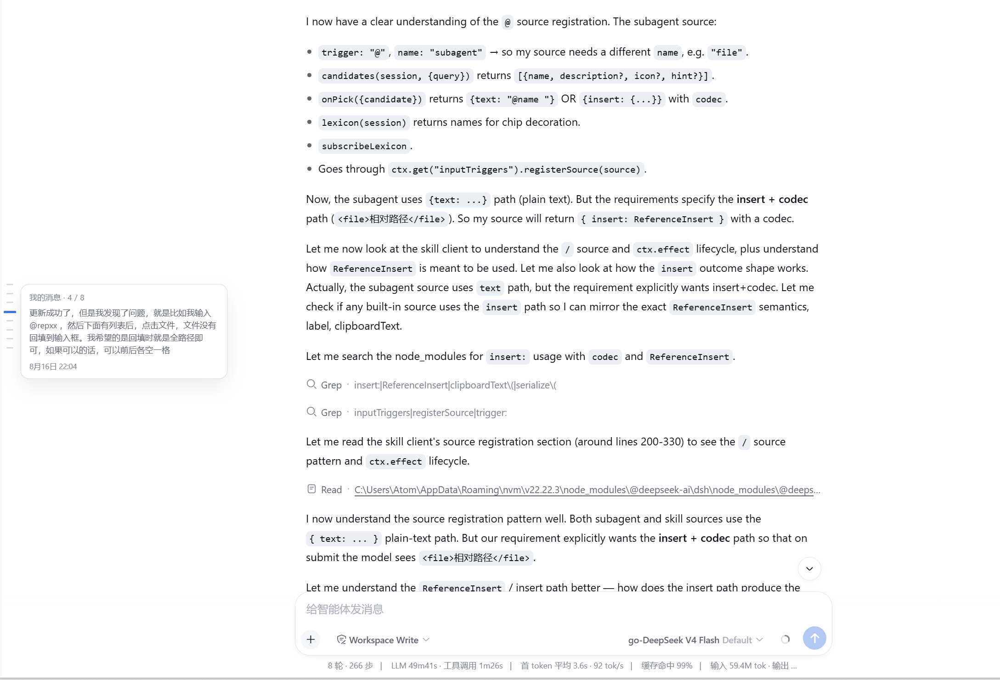

# 用户消息导航条 · Message Minimap

<div align="center">
  <a href="README.md">中文</a> · <b>English</b>
</div>

> **A slim minimap rail on the RIGHT edge of the DeepSeek Harness Web GUI chat pane: every message you sent becomes a tick — hover for a preview, click to jump, drag to scan long sessions.**

[](LICENSE)

---

## 1. The problem it solves

In a long session, going back to "what did I say earlier?" means endless wheel scrolling. The assistant's replies are long and dense, and your own messages get buried in between.

This plugin adds a thin navigation rail on the **right edge** of the chat pane (like the VS Code minimap) — the official turn rail owns the left gutter, so the two rails keep to their own sides:

```
chat scroll pane (overflow-y: auto, long sessions are paged)
  │  each turn = one tick (including not-yet-loaded history, from the official turnOutline projection)
  │  ticks of in-viewport turns = bold highlight
  │
  ▼  hover a tick → preview card (index / total + prompt excerpt + date/time line)
  ▼  click a tick → smooth-scroll to that turn (official loadThrough(seq) pages it in first)
  ▼  click/drag the rail → proportional jump
```

**Read-only**: the client only reads the conversation DOM already rendered in the browser (chat rows carry stable `data-chat-flow-kind` / `data-chat-flow-key` / `data-chat-turn` anchors) and scrolls the existing chat scroll container. The full list comes from the official **`turnOutline` session projection** (whole-log turn outline: turn number, `turn/start` seq, bounded prompt/response previews), and paging uses the official **`sessions.binding(id).session.loadThrough(seq)`** ("page backwards until the window covers seq").

> From 0.5.0 through 0.6.x the **host half is a no-op**: no route, no session-log parsing. Since 0.7.0 it only registers one lightweight `messageMinimapTimes` session projection (folding each `turn/start` `time` so unloaded turns can show their send date/time); it **still opens no route and reads no session-log file**, and stays independent of the on-disk log layout (`session.v3/v4.jsonl.zstd`, new container format since 0.1.7).

> Since 0.6.0 the rail is **mirrored to the right edge** of the chat pane: DSH's official turn rail now lives on the left, so the two no longer crowd the same gutter. The rail hugs the left side of the scrollbar, ticks pin to the right edge and grow leftward, and the hover preview opens to the left. The whole-session turn list is unchanged. Where DSH's Session panel owns the right side, the rail moves into the clear band after the message column for a docked panel and yields while a floating panel is open; vertically it centers in the band above the composer, so it never covers the input card.

> Since 0.7.0 the hover card **carries the send date/time**: a rendered turn uses its own message clock; an unloaded turn uses the host `messageMinimapTimes` projection's `turn/start` time. Today shows `HH:mm`, older dates add the local month/day or year/month/day (following the interface language).

> Compatibility: requires **DSH ≥ 0.1.7** (`turnOutline` is provided by `@deepseek-ai/dsh-session-turn-outline`, registered by the `dsh-web-app` composition). On older versions the rail degrades to loaded turns only; when `messageMinimapTimes` is not registered (older host or a missing dependency), the time line for unloaded turns falls back to empty while everything else keeps working.

## 2. Features

- ✅ A **compact, vertically centered** rail on the chat pane's right edge, just left of the scrollbar (not full height) — zero layout interference; ticks pin to the right edge and grow leftward on hover.
- ✅ Coexists with DSH's right-side chrome: a docked Session panel moves the rail into the clear band after the message column, a floating panel makes it yield, and the rail stays above the composer.
- ✅ **One tick per turn** (i.e. per message you sent), evenly spaced on the rail (oldest at top, newest at bottom) — never scattered by message sizes.
- ✅ **Immune to history paging**: ticks cover ALL turns (including history not yet rendered via "load older") — sourced from the official `turnOutline` projection, so the full ladder shows as soon as the session opens, **without scrolling up yourself**.
- ✅ **Exact jumps**: an unloaded turn is fetched with the official `loadThrough(seq)` in one call ("page backwards until the window covers that turn's `turn/start` seq") — no blind page-by-page probing, and no drift.
- ✅ **Ticks of the turns inside the viewport are auto-bolded**, following the scroll in real time.
- ✅ **Fisheye magnification while sweeping the rail**: the tick under the pointer grows longest, its neighbors grow by a cosine distance falloff (the width follows the pointer immediately; color/opacity ease) — spot the target at a glance.
- ✅ **Hovering a tick — or anywhere on the rail, which previews the nearest tick —** pops a preview card: `My message · 3 / 12` plus the prompt excerpt and a dedicated date/time line (a rendered turn uses its own clock; an unloaded turn uses the host turn-time projection).
- ✅ **Clicking a tick** smooth-scrolls to that turn (parked ~18% below the pane top).
- ✅ **Clicking or dragging the rail background** jumps proportionally, like a scrollbar.
- ✅ Follows streaming output, history loading, session switches and window resizes automatically (MutationObserver + scroll/resize + polling fallback).
- ✅ Hides itself when the content doesn't overflow, when there are no turns, or on the new-session hero screen — zero layout interference.
- ✅ Bilingual (zh/en) UI strings following the GUI language.
- ✅ Keyboard accessible: ticks are native `<button>`s — Tab to focus, Enter to jump.

**MVP limitations**: no ticks for assistant messages/errors/branches; no text search over ticks; no persisted on/off toggle (always auto show/hide).

## Preview

| Hover a tick: preview card (excerpt + dedicated date/time line) |
|:---:|
|  |

> The screenshot shows the 0.5.x left-side position; the preview content is unchanged — since 0.6.0 the rail sits on the right and the card opens on its left.

## 3. Directory layout

```
dsh-message-minimap/        # repo root = npm package root
├── package.json            # dsh.bundle.patch + dsh.client (browser declaration) + exports["./client"]
├── cordis.patch.yml        # composition row: a single plugin record (no route, no config)
├── LICENSE                 # MIT
├── screenshot/             # screenshots for the README "Preview" section
└── lib/
    ├── index.js            # host half: Loader marker + optional messageMinimapTimes projection
    ├── projection.js       # host projection: folds turn/start time (only dependency: zod)
    └── client.js           # browser bundle: the rail (mounted via conversation.session.header.utilities)
```

## 4. Quick start

One-line install (GitHub):

```powershell
dsh plugin --profile web add github:AFAP/dsh-message-minimap
```

Then **restart `dsh web`** to take effect.

> After installation the plugin lives at `$DSH_HOME\profiles\web\node_modules\dsh-message-minimap` (cloned by pnpm from GitHub), independent of the source checkout location.

Upgrade:

```powershell
dsh plugin --profile web update dsh-message-minimap
```

Uninstall:

```powershell
dsh plugin --profile web remove dsh-message-minimap
```

### Manual install from a source directory (for equivalent verification)

```powershell
dsh plugin --profile web add "D:\path\to\dsh-message-minimap"
```

### Verify it loaded

Open a session **with several exchanges whose content overflows and scrolls** → a ticked rail appears at the chat pane's right edge; hovering a tick shows the message excerpt.

## 5. Usage

1. Open any long historical session (or chat past one screenful).
2. Look at the centered rail on the chat pane's right edge: each small tick is **one message you sent (one turn)**; the ticks of **turns currently inside the viewport** are bolded.
3. **Hover a tick — or anywhere on the rail, which previews the nearest tick**: a preview card pops to the left with "My message · n / total", the prompt opening and the send date/time (today `HH:mm`, older dates included).
4. **Click a tick**: smooth-scrolls to that turn; if it hasn't been rendered by "load older" paging yet, the plugin calls the official `loadThrough(seq)` to page it in first, then jumps.
5. **Click or drag the rail outside the ticks**: proportional jump (equivalent to scrollbar dragging).
6. The rail hides itself when the session is too short (under one screen), has no turns, or shows the blank new-session hero.

## 6. Official capabilities it relies on

No route is added: the plugin only consumes official DSH interfaces (available since 0.1.7):

| Capability | Purpose |
|---|---|
| `turnOutline` session projection | Whole-log turn outline: each turn's `turn`, its `turn/start` `seq`, and bounded prompt/response previews. The ticks ARE its entries — **no manual "load older" needed**. |
| Custom `messageMinimapTimes` session projection | The host half folds `turn/start` `time` so every turn (including unloaded history) has a send time; **no route, no session-log read**. |
| `sessions.binding(sessionId).session.loadThrough(seq)` | The official jump loader: pages backwards until the window covers `seq`. Clicking an unloaded tick calls it once. |
| `conversation.loadOlder()` / the "load older" button | Fallback when `loadThrough` is unavailable: pull one page at a time. |
| DOM anchors `data-chat-turn` / `data-chat-flow-kind` / `data-chat-flow-key` / `data-chat-flow` | Decide whether a turn is rendered, locate the scroll target, measure "in view". |
| The `conversation.session.header.utilities` slot | Mount the rail (always mounted for the active session). |

## 7. Implementation notes

| Concern | Approach |
|---|---|
| Anchor source | The chat package stamps every rendered row with `data-chat-flow-kind` (user rows are kind `"user"`), `data-chat-flow-key`, and the owning turn number `data-chat-turn`; the paged column carries `data-chat-flow`. |
| Full-list data | `props.useProjection("turnOutline")` yields every turn (`turn` / `seq` / `prompt` / `response`); when the projection is missing the rail falls back to rendered turns only. |
| Time data | The host half folds each `turn/start` `time` into the `messageMinimapTimes` projection (`{turn, time}`, strictly increasing by turn); the client prefers a rendered turn's DOM clock and formats the projection time for unloaded turns. |
| Jumping to an unloaded turn | Call `loadThrough(seq)` (the official exact loader), then poll `[data-chat-turn]` until the turn appears and land on it; if `loadThrough` is unavailable, fall back to repeated page pulls (service `loadOlder()`, then the pager button) and stop with a warning after 3 stalled cycles. |
| Loaded detection | Purely "does a row with this `data-chat-turn` exist" — independent of window length or whether a page contains user messages. |
| Scroll container | Nearest `overflow-y: auto/scroll` ancestor of the first visible flow item; auto-hides in the export layout (`data-conversation-scroll`, nothing scrolls). |
| Geometry mapping | The tick column is compact and centered (fixed 10px pitch; height ≈ min(10px × count + 28px, band height × 0.55)); it hugs the pane's right edge, just left of the scrollbar, moves after the message column while a docked Session panel owns the right side, and hides while a floating panel is open. The band is the scrollport height minus the composer height (official `--dsh-composer-height`); ticks are **evenly spaced by index**. Rail drags map proportionally to scroll position; row offsets are only used for jump targets and in-view detection. |
| Sync | `MutationObserver` (childList/subtree/characterData, plus the scrollport's `style` and `data-session-panel`, covering streaming and composer/panel changes) + container `scroll` + `ResizeObserver` + 1s polling fallback (late mount / session switch), rAF-throttled with shallow equality; projection changes drive ticks through React rendering. |
| Time line | `turnOutline` carries no timestamps: a rendered turn lends its clock from the user bubble's time element (class suffix `timeStart`/`timeEnd`, independent of the build hash); an unloaded turn uses the host `messageMinimapTimes` projection's `turn/start` time (today `HH:mm`, older dates add the locale date; following the interface language). The line stays empty only when neither source exists. |
| Mount point | The `conversation.session.header.utilities` slot (always mounted for the active session); the component renders only the `position: fixed` rail, no inline chrome. |
| Styling | Injected `<style data-plugin-css>` like the shipped bundles; everything uses DSW theme variables, auto light/dark. |

## 8. Troubleshooting

| Symptom | Where to look |
|---|---|
| Rail not visible | Confirm `dsh web` was restarted; the session needs turns and scrollable overflow; search F12 Console for `dsh-message-minimap`. |
| Ticks cover only the recent slice | The `turnOutline` projection isn't in effect: check DSH ≥ 0.1.7 and that the `dsh-web-app` composition includes `session-turn-outline` (`dsh --profile web --dump-config \| Select-String turn-outline`); without it the plugin degrades to rendered-only ticks. |
| Clicking an early tick doesn't jump | The plugin calls `loadThrough(seq)` (retrying every second if needed) and lands once the turn enters the DOM; if history is exhausted and the turn doesn't exist (forked/deleted), it stops in place. On give-up the Console logs a `[dsh-message-minimap]` warning — set `localStorage.dmm.debug=1`, reload and reproduce to capture the trace. |
| Tick positions drift | Async image/attachment loads change heights — the MutationObserver self-corrects; if it persists, scroll or resize once to force a recompute. |
| Clicks don't jump | Check whether you're in the export/print layout (`data-conversation-scroll`) — it has no internal scroll container and the plugin hides itself. |
| Styling looks off | Confirm the theme variables (`--dsw-*`) exist; the plugin ships no colors of its own and follows the DSW theme. |

## 9. Security & compliance

- **Read-only**: no business-DOM mutation, no event interception (outside its own rail), no file reads or writes, no network requests.
- **Minimal host capability**: the host half only registers one `messageMinimapTimes` projection (folding `turn/start` `time`) — no route, no session-log access, no config keys.
- **Minimal disclosure**: it only uses the bounded turn previews and `turn/start` times the official projections provide; no extra session content is read or stored.
- **No persistence**: nothing written to localStorage / cookies (except the optional `dmm.debug` switch you set yourself); uninstalling leaves no trace.

## 10. Development & build

Plain JS, no build step. `lib/index.js` (host half) has no static imports; it lazily loads `lib/projection.js` (only dependency: zod) to register the optional projection. `lib/client.js` is a classic script (`window.__ModuleLoader__.load`) served directly by the client module system at `/plugins/dsh-message-minimap/client.js`.

## 11. License

MIT © AFAP
