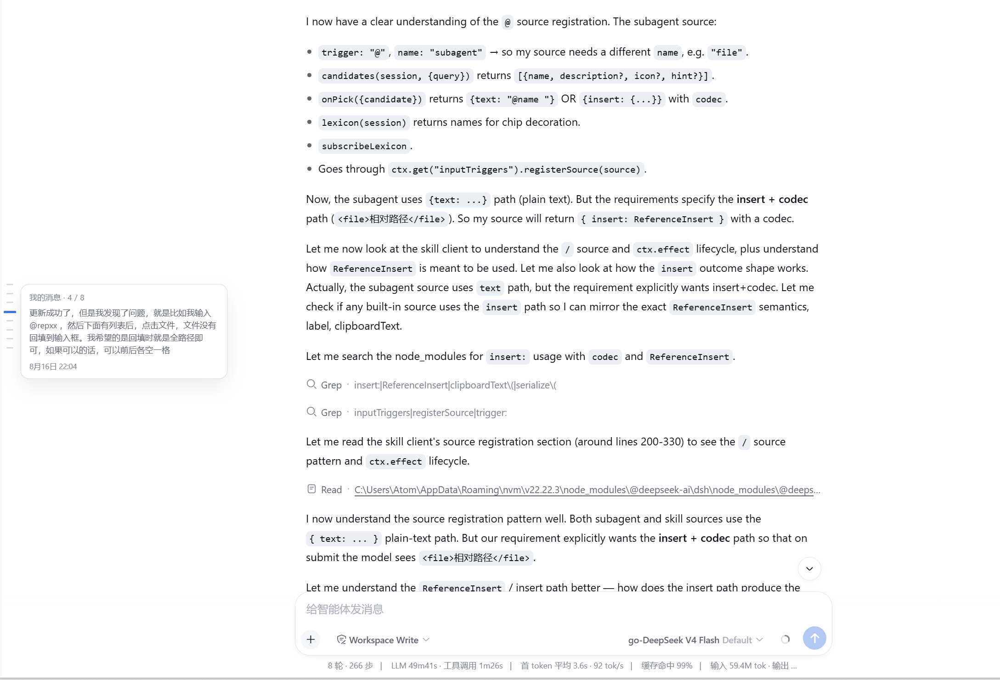

# 用户消息导航条 · Message Minimap

<div align="center">
  <b>中文</b> · <a href="README.en.md">English</a>
</div>

> **在 DeepSeek Harness Web GUI 会话聊天窗的右边缘显示一条迷你导航条：每一条你发送的消息都是刻度，悬停看摘要，点击即跳转，拖动可快速扫读长会话。**

[](LICENSE)

---

## 1. 它解决了什么问题

长会话里想回看"我之前是怎么说的"时，只能一路滚轮硬翻。AI 的回复往往又长又密，自己发过的消息被埋在中间很难找。

本插件在聊天窗**右边缘**加一条细导航条（类似 VS Code 的 minimap）——官方的轮次轨道占据左侧装订线，两条轨道各守一边、互不遮挡：

```
聊天滚动窗 (overflow-y: auto，长会话分页加载)
  │  每一轮对话 = 一个刻度（含未加载的历史，来自官方 turnOutline 投影）
  │  视口内的刻度 = 加粗高亮
  │
  ▼  悬停刻度 → 预览卡片（第几条 / 共几条 + 提示词摘要 + 日期时间行）
  ▼  点击刻度 → 平滑滚动到该轮（未加载的先按官方 loadThrough(seq) 精确翻页）
  ▼  点击/拖动轨道 → 按比例跳转
```

**只读**：客户端只读取浏览器中已渲染的会话 DOM（聊天行带有稳定的 `data-chat-flow-kind` / `data-chat-flow-key` / `data-chat-turn` 锚点），滚动的是既有的聊天滚动容器。全量数据来自 DSH 官方的 **`turnOutline` 会话投影**（整段日志的轮次大纲：轮次号、`turn/start` 序号、提示词与回复的有界预览），翻页调用官方的 **`sessions.binding(id).session.loadThrough(seq)`**（"向后翻页直到窗口覆盖该序号"）。

> **0.5.0–0.6.x** 的宿主半部是空实现：不开路由、不解析会话日志文件。**0.7.0 起**它只额外注册一个轻量的 `messageMinimapTimes` 会话投影（折叠 `turn/start` 的 `time`，供未加载轮次显示发送日期时间），**仍然不开路由、不读日志文件**，也不依赖日志落盘格式（0.1.7 起日志已改为 `session.v3/v4.jsonl.zstd` 新容器格式）。

> **0.6.0 起导航条镜像到聊天窗右侧**：DSH 官方的轮次轨道改到左侧后，两者不再挤在同一条装订线里。轨道贴着滚动条左侧，刻度**向右贴边、向左生长**，悬停预览卡开在轨道左侧；整段会话的全部轮次保持不变。右侧若被 DSH 会话面板占用：停靠面板会把导航条推到正文列右侧的空带（不跟面板和拖宽手柄抢位），浮层面板打开时导航条暂时让位；纵向只在输入框上方的可视带里居中，不会压到输入卡。

> **0.7.0 起悬停卡补上发送日期时间**：已加载轮次取用户气泡自带的日期时间；未加载轮次由宿主 `messageMinimapTimes` 投影补 `turn/start` 时间。今天显示 `HH:mm`，非今天显示月日/年月日 + `HH:mm`（跟随界面语言），不再出现"老消息没有时间"。

> 兼容性：需要 **DSH ≥ 0.1.7**（`turnOutline` 由 `@deepseek-ai/dsh-session-turn-outline` 提供、`dsh-web-app` 组合注册）。旧版本上投影缺失时，导航条自动降级为"仅已加载轮次"模式；`messageMinimapTimes` 未注册（旧宿主或依赖缺失）时，未加载轮次的时间行回退为空，其余功能不变。

## 2. 功能特性

- ✅ 聊天窗右侧一条**紧凑居中**的导航条（贴滚动条左侧，不铺满全高），不干扰布局；刻度向右贴边、悬停向左生长。
- ✅ 与 DSH 右侧界面共存：停靠的会话面板占住右侧装订线时，导航条自动改贴正文列右侧的空带；浮层面板打开时暂时让位；纵向避开输入卡。
- ✅ **每一轮对话一个刻度**（即你发过的每条消息），在刻度列上均匀分布（上旧下新），不随消息长短散开。
- ✅ **长会话分页也不怕**：刻度覆盖**全部轮次**（含"加载更多"未渲染的历史）——数据取自官方 `turnOutline` 投影，**不需要你手动往上滑**，打开会话即显示完整刻度。
- ✅ **跳转精确**：未加载的轮次直接调用官方 `loadThrough(seq)` 一次翻到位（"向后翻页直到窗口覆盖该轮 `turn/start` 序号"），不依赖逐页试探，也不会跳偏。
- ✅ **当前视口内的刻度自动加粗高亮**，随滚动实时更新。
- ✅ **鼠标扫过刻度列时鱼眼放大**：指针下的刻度变得最长，邻近刻度按距离渐次微长（余弦衰减；宽度随指针即时变化，颜色/透明度平滑过渡），一眼定位。
- ✅ **悬停刻度（或轨道上任意位置，自动取最近刻度）**弹出预览卡片：`我的消息 · 3 / 12` + 提示词摘要 + 独立日期时间行（已加载轮次取该轮时钟；未加载轮次由宿主投影补齐）。
- ✅ **点击刻度**平滑滚动到该轮（停靠在视口上方约 18% 处）。
- ✅ **点击/按住拖动轨道背景**按比例跳转，像滚动条一样快速扫读。
- ✅ 流式输出、加载历史、切换会话、窗口缩放时自动跟随（MutationObserver + scroll/resize + 轮询兜底）。
- ✅ 内容未溢出、无轮次、或在新会话引导页时自动隐藏，不干扰布局。
- ✅ 中英双语界面文案，跟随界面语言。
- ✅ 键盘可达：刻度是原生 `<button>`，可 Tab 聚焦后回车跳转。

**MVP 暂不支持**：不标注 AI 消息/错误/分支；不做按文本搜索刻度；不做持久化开关（始终自动显示/隐藏）。

## 效果预览

| 悬停刻度：预览卡片（摘要 + 独立日期时间行） |
|:---:|
|  |

> 截图为 0.5.x 的左侧位置；预览内容不变，0.6.0 起轨道在聊天窗右侧、预览卡开在它的左侧。

## 3. 目录结构

```
dsh-message-minimap/   # 仓库根 = npm 包根
├── package.json            # dsh.bundle.patch + dsh.client（浏览器端声明）+ exports["./client"]
├── cordis.patch.yml        # 组合行：仅插入一行插件记录（无路由、无配置）
├── LICENSE                 # MIT
├── screenshot/             # 效果截图（README「效果预览」用）
└── lib/
    ├── index.js            # 宿主半部：Loader 标记 + 可选注册 messageMinimapTimes 投影
    ├── projection.js       # 宿主投影：折叠 turn/start 的 time（唯一依赖：zod）
    └── client.js           # 浏览器 bundle：导航条（conversation.session.header.utilities 挂载）
```

## 4. 快速开始

一键安装（GitHub）：

```powershell
dsh plugin --profile web add github:AFAP/dsh-message-minimap
```

然后**重启 `dsh web`** 生效。

> 安装后插件位于 `$DSH_HOME\profiles\web\node_modules\dsh-message-minimap`（pnpm 从 GitHub 克隆），与源码仓库位置无关。

升级：

```powershell
dsh plugin --profile web update dsh-message-minimap
```

卸载：

```powershell
dsh plugin --profile web remove dsh-message-minimap
```

### 从源码目录手动安装（等价验证用）

```powershell
dsh plugin --profile web add "D:\path\to\dsh-message-minimap"
```

### 验证是否加载成功

打开一个**有多条往返消息、内容已溢出可滚动**的会话 → 聊天窗右边缘出现一条带刻度的细条，悬停刻度能看到消息摘要即可。

## 5. 使用

1. 打开任意历史会话（或聊到内容超过一屏）。
2. 看聊天窗右侧居中的导航条：每个小刻度是**你发过的一条消息（一轮对话）**，**当前在视口内的刻度**会加粗高亮。
3. **悬停刻度（或轨道上任意位置，取最近刻度）**：左侧弹出预览卡，显示"我的消息 · n / 总数"、提示词开头与发送日期时间（今天 `HH:mm`，非今天带日期）。
4. **点击刻度**：平滑滚动到那一轮；若它还没被"加载更多"渲染出来，插件会调用官方 `loadThrough(seq)` 一次翻到位再跳转。
5. **点击或按住拖动刻度以外的轨道**：按比例跳转（等价于滚动条拖拽）。
6. 会话太短（不足一屏）、没有轮次、或在空白新会话页时，导航条自动隐藏。

## 6. 依赖的官方能力

本插件不新增任何路由，只消费 DSH 官方接口（0.1.7 起可用）：

| 能力 | 用途 |
|---|---|
| `turnOutline` 会话投影 | 整段日志的轮次大纲：每轮的 `turn`、`turn/start` 的 `seq`、提示词与回复的有界预览。刻度就是它的条目（**因此不需要手动加载更多**）。 |
| `sessionProjections` 自定义投影 `messageMinimapTimes` | 宿主半部折叠 `turn/start` 的 `time`，给全部轮次（含未加载历史）提供发送时间；**不开路由、不读日志**。 |
| `sessions.binding(sessionId).session.loadThrough(seq)` | 官方"跳转加载器"：向后翻页直到窗口覆盖该 `seq`。点击未加载的刻度时调用它一次翻到位。 |
| `conversation.loadOlder()` / "加载更多"按钮 | `loadThrough` 不可用时的兜底：逐页向上翻。 |
| DOM 锚点 `data-chat-turn` / `data-chat-flow-kind` / `data-chat-flow-key` / `data-chat-flow` | 判断某轮是否已渲染、定位滚动目标、测量"视口内"。 |
| `conversation.session.header.utilities` 槽位 | 挂载导航条（活动会话常驻）。 |

## 7. 实现要点

| 关注点 | 做法 |
|---|---|
| 锚点来源 | 聊天包给每个渲染行加上 `data-chat-flow-kind`（用户行 kind 为 `"user"`）、`data-chat-flow-key`、以及所属轮次 `data-chat-turn`；分页列带有 `data-chat-flow`。 |
| 全量数据 | `props.useProjection("turnOutline")` 取全部轮次（`turn` / `seq` / `prompt` / `response`）；投影未就绪或不可用时退回"仅已渲染轮次"。 |
| 时间数据 | 宿主半部把 `turn/start` 的 `time` 折叠成 `messageMinimapTimes` 投影（`{turn, time}`，按轮次严格递增）；客户端优先用已渲染轮次的 DOM 时钟，未加载轮次用投影时间格式化。 |
| 未加载跳转 | 目标轮未渲染时调用 `loadThrough(seq)`（官方精确加载），随后轮询 `[data-chat-turn]` 直到该轮出现再定位；`loadThrough` 不可用时退回逐页拉取（服务 `loadOlder()`，再兜底点分页按钮），连续 3 个周期无进展即停止并告警。 |
| 已加载判断 | 只取决于 DOM 中是否存在该轮次的行（`data-chat-turn`），与窗口长度、页内是否含用户消息都无关。 |
| 滚动容器 | 从第一个可见 flow item 向上找最近的 `overflow-y: auto/scroll` 祖先；导出布局（`data-conversation-scroll`，不滚动）下自动隐藏。 |
| 几何映射 | 刻度列紧凑居中（间距固定 10px，高 ≈ min(10px × 数量 + 28px, 可视带高 × 0.55)），吸附聊天窗右缘、紧贴滚动条左侧；停靠会话面板占用右侧时改贴正文列右侧，浮层面板打开时隐藏；可视带高 = 滚动窗高 − 输入框高（官方 `--dsh-composer-height`）；刻度按序号**均匀分布**；拖动轨道时按比例换算滚动位置；行偏移只用于跳转目标与"视口内"判定。 |
| 数据同步 | `MutationObserver`（childList/subtree/characterData，另观察 style 与 `data-session-panel`，覆盖流式输出及输入框/会话面板变化）+ 容器 `scroll` + `ResizeObserver` + 1s 轮询兜底（应对迟挂载/会话切换），rAF 节流 + 浅比较避免渲染抖动。投影变化经 React 渲染自动驱动刻度。 |
| 时间行 | `turnOutline` 不含时间戳：已渲染轮次从该轮用户气泡的时间元素（类名后缀 `timeStart`/`timeEnd`，与哈希前缀无关）读取；未渲染轮次用宿主 `messageMinimapTimes` 投影的 `turn/start` 时间补齐（今天 `HH:mm`，非今天带日期；跟随界面语言）；两者都没有时该行留空。 |
| 挂载点 | `conversation.session.header.utilities` 槽位（活动会话常驻），组件本身只渲染 `position: fixed` 的轨道，无内联占位。 |
| 样式 | 与官方包一致地注入 `<style data-plugin-css>`，全部使用 DSW 主题变量，自动适配明暗主题。 |

## 8. 日志与排错

| 现象 | 排查方向 |
|---|---|
| 看不到导航条 | 确认已重启 `dsh web`；会话需已有轮次且内容可滚动；F12 Console 搜 `dsh-message-minimap`。 |
| 刻度只覆盖最近一段 | `turnOutline` 投影未生效：确认 DSH ≥ 0.1.7 且 `dsh-web-app` 组合包含 `session-turn-outline`（`dsh --profile web --dump-config \| Select-String turn-outline`）；投影缺失时插件降级为仅显示已渲染轮次。 |
| 点击早期刻度没跳转 | 插件调用 `loadThrough(seq)` 精确翻页（必要时每秒重试），目标轮进 DOM 后定位；历史耗尽仍不存在（分岔/已删除）会停在原地。放弃时 Console 输出 `[dsh-message-minimap]` 警告——设 `localStorage.dmm.debug=1` 后重载复现可拿到完整翻页日志。 |
| 刻度位置偏移 | 偶发的图片/附件异步加载会改变高度——MutationObserver 会自动校正；若持续异常，滚动一下或缩放窗口触发重算。 |
| 点击不跳转 | 检查是否在导出/打印式布局（`data-conversation-scroll`）下——该布局无内部滚动容器，插件自动隐藏。 |
| 样式异常 | 确认主题变量（`--dsw-*`）存在；本插件不自带配色，全部跟随 DSW 主题。 |

## 9. 安全与合规

- **只读**：不修改 DOM 业务结构、不拦截事件（除自身轨道）、不读写任何文件、不发起网络请求。
- **宿主能力最小化**：宿主半部只注册一个 `messageMinimapTimes` 投影（折叠 `turn/start` 的 `time`），不开路由、不读会话日志、无配置项。
- **数据最小化**：只使用官方投影的轮次预览与 `turn/start` 时间（有界数据），不额外读取或落盘任何会话内容。
- **无持久化**：不写 localStorage / cookie（除可选的 `dmm.debug` 调试开关，由你自己设置）；卸载即无痕。

## 10. 开发与构建

纯 JS 无构建步骤。`lib/index.js` 宿主半部没有静态 import，按需动态加载 `lib/projection.js`（只依赖 zod）注册可选投影；`lib/client.js` 是经典脚本（`window.__ModuleLoader__.load`），由 client 模块系统按 `/plugins/dsh-message-minimap/client.js` 直接服务。

## 11. License

MIT © AFAP
